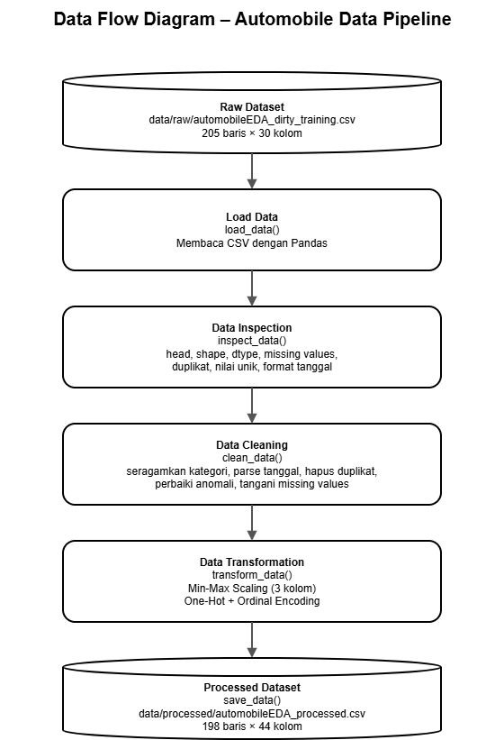

# Data Preparation & Pipeline Project – Automobile Dataset

Pipeline ETL sederhana dengan Python dan Pandas untuk mengolah dataset otomotif mentah (`automobileEDA_dirty_training.csv`) menjadi dataset bersih yang siap dipakai untuk analisis atau pemodelan (`automobileEDA_processed.csv`).

## Deskripsi Dataset

Dataset berisi **205 data mobil** dengan **30 kolom**. Kolom-kolomnya mencakup:

- **Identitas dan kategori**: `make`, `body-style`, `drive-wheels`, `fuel-system`, dll.
- **Dimensi**: `wheel-base`, `length`, `width`, `height`, `curb-weight`.
- **Mesin dan performa**: `engine-size`, `horsepower`, `peak-rpm`, `city-mpg`, `highway-mpg`, dll.
- **Harga**: `price`.
- **Tanggal transaksi**: `transaction_date`.

Kolom `price` diperlakukan sebagai **variabel target** untuk pemodelan berikutnya.

## Sumber Dataset

Disediakan oleh mentor AI Engineering Bootcamp (`Dataset_Sesi_3.zip`). Pipeline hanya memakai `automobileEDA_dirty_training.csv` sebagai input. Dataset ini merupakan versi "kotor" dari dataset Automobile (UCI Machine Learning Repository) yang sudah melalui tahap EDA.

## Struktur Folder

```
data-pipeline-assignment/
├── data/
│   ├── raw/
│   │   └── automobileEDA_dirty_training.csv   # dataset mentah (tidak diubah)
│   └── processed/
│       └── automobileEDA_processed.csv        # hasil pipeline
├── src/
│   └── pipeline.py                            # script pipeline ETL
├── documentation/
│   └── data-flow-diagram.png                  # diagram alur data
├── README.md
└── requirements.txt
```

## Kondisi Awal Dataset

Hasil fungsi `inspect_data()`:

| Aspek | Temuan |
| --- | --- |
| Ukuran awal | 205 baris × 30 kolom |
| Missing values | 17 sel kosong di 7 kolom: `stroke` (4), `horsepower` (3), `price` (3), `transaction_date` (2), `make` (2), `num-of-doors` (2), `horsepower-binned` (1) |
| Duplicate records | 4 baris identik (baris 201–204 adalah salinan baris 5, 25, 60, 100) |
| Tipe data belum sesuai | `transaction_date` masih berupa teks (`str`), bukan tanggal. `num-of-doors` dan `num-of-cylinders` berisi angka yang ditulis sebagai kata (`"two"`, `"four"`) |
| Kolom lain | Kolom numerik sudah bertipe angka. `length` dan `width` sudah dinormalisasi dari sumbernya (rentang 0–1) |

## Permasalahan yang Ditemukan

1. **Format tanggal tidak seragam.** `transaction_date` memakai 4 format berbeda:

   | Pola | Contoh | Arti | Jumlah |
   | --- | --- | --- | --- |
   | `YYYY-MM-DD` | `2025-01-01` | 1 Januari | 51 |
   | `DD/MM/YYYY` | `02/01/2025` | 2 Januari | 52 |
   | `MM-DD-YYYY` | `01-03-2025` | 3 Januari | 50 |
   | `DD-Mon-YYYY` | `04-Jan-2025` | 4 Januari | 50 |

   Format `MM-DD-YYYY` terbukti dari nilai seperti `02-16-2025` (tidak ada bulan ke-16). Tanggal di dataset berurutan per hari mengikuti urutan baris.

2. **Penulisan kategori tidak konsisten** (huruf besar/kecil, spasi di akhir, sinonim):

   | Kolom | Nilai bermasalah | Seharusnya |
   | --- | --- | --- |
   | `make` | `ALFA-ROMERO`, `Audi`, `BMW`, `"dodge  "`, `"mercury  "`, `"porsche  "` | huruf kecil, tanpa spasi |
   | `body-style` | `SEDAN`, `Sedan` | `sedan` |
   | `drive-wheels` | `RWD`, `AWD` | `rwd`, `4wd` |
   | `fuel-system` | `MPFI`, `Mpfi` | `mpfi` |

3. **4 baris duplikat** yang identik di semua kolom.
4. **Missing values** di 7 kolom (lihat tabel kondisi awal).
5. **Nilai tidak wajar.** Satu mobil diesel (`mercedes-benz`, `compression-ratio` 21.5) tercatat memakai `fuel-system` = `Mpfi`. Padahal 20 mobil diesel lainnya semuanya memakai `idi` (injeksi diesel), dan `mpfi` hanya dipakai mobil bensin.
6. **Satu nilai `horsepower-binned` kosong** pada mobil Jaguar dengan 262 hp. Dari data yang ada, kelasnya bisa ditentukan: Low ≤ 101, Medium 102–155, High ≥ 156.

## Data Cleaning

Fungsi `clean_data()` menjalankan langkah-langkah berikut secara berurutan:

| # | Kolom | Masalah | Metode | Alasan |
| --- | --- | --- | --- | --- |
| 1 | `make`, `body-style`, `drive-wheels`, `fuel-system` (dan kolom kategorikal lain) | Huruf dan spasi tidak konsisten | `str.strip()` + `str.lower()`. `AWD` dipetakan ke `4wd` | Agar satu kategori tidak terhitung sebagai beberapa kategori. `AWD` dan `4wd` sama-sama berarti semua roda menggerakkan, dan `4wd` adalah label baku di dataset |
| 2 | `transaction_date` | Teks dengan 4 format | Format dikenali dari pola setiap nilai (regex), lalu di-parse dengan format yang sesuai menjadi `datetime` | Parser otomatis bisa salah membaca `01-03-2025` sebagai 1 Maret. Dengan pola eksplisit hasilnya pasti benar |
| 3 | Semua kolom | 4 baris duplikat | `drop_duplicates()`, dijalankan setelah langkah 1–2 | Data ganda membuat statistik dan model bias. Penyeragaman dilakukan lebih dulu agar duplikat yang hanya berbeda penulisan ikut terdeteksi |
| 4 | `fuel-system` | Mobil diesel dengan `mpfi` | Diganti dengan sistem bahan bakar dominan pada mobil diesel (`idi`) | Kombinasi diesel dengan `mpfi` tidak ada di data lain. Semua mobil diesel lain memakai `idi` |
| 5 | `price` | 3 kosong | **Baris dihapus** | `price` adalah target. Mengisi target dengan tebakan akan mengajari model nilai palsu. Yang hilang hanya 3 baris (1,5%) |
| 6 | `transaction_date` | 2 kosong | Interpolasi dari tanggal sebelum dan sesudahnya | Tanggal berurutan harian, sehingga nilai yang hilang bisa ditentukan dengan pasti (mis. di antara 9 dan 11 Februari → 10 Februari) |
| 7 | `make` | 1 kosong (setelah duplikat dihapus) | Dicari mobil lain dengan spesifikasi identik (`wheel-base`, `engine-size`, `horsepower`, `engine-type`, `fuel-system`, `bore`). Kalau tidak ada yang cocok, diisi `unknown` | Mobil tanpa merek ini spesifikasinya sama persis dengan Nissan di baris sebelahnya (wheel-base 100.4, mesin 181 cc, 152 hp, harga 13.499), sehingga diisi `nissan` |
| 8 | `num-of-doors` | 2 kosong | Modus per `body-style` | Keduanya sedan, dan sedan di dataset ini paling banyak berpintu empat (`four`). Lebih tepat daripada modus keseluruhan |
| 9 | `stroke` | 4 kosong | Median (3.29) | Data numerik kontinu. Median tidak terpengaruh outlier, dan yang hilang sedikit (2%) sehingga tidak perlu membuang baris |
| 10 | `horsepower` | 3 kosong | Median per kelompok `horsepower-binned` | Kelas tenaga (Low/Medium/High) tetap tersedia, sehingga nilai isian tetap konsisten dengan kelasnya |
| 11 | `horsepower-binned` | 1 kosong | Ditentukan dari `horsepower` memakai batas kelas yang ada di data | Kelas adalah turunan langsung dari horsepower (262 hp → `High`) |

Kolom yang diubah: `make`, `body-style`, `drive-wheels`, `fuel-system`, `transaction_date`, `num-of-doors`, `stroke`, `horsepower`, `horsepower-binned`.

Tidak ada outlier numerik yang dihapus. Nilai ekstrem seperti `compression-ratio` 21–23 (mesin diesel) dan `price` 45.400 (mobil mewah) adalah nilai asli, bukan kesalahan.

### Jumlah Data Sebelum dan Sesudah Cleaning

| Metrik | Sebelum | Sesudah |
| --- | --- | --- |
| Jumlah baris | 205 | 198 |
| Duplicate records | 4 | 0 (4 dihapus) |
| Baris tanpa `price` | 3 | 0 (3 dihapus) |
| Total missing values | 17 | 0 |
| Variasi nilai `make` | 27 (+ kosong) | 22 |
| Variasi nilai `body-style` | 7 | 5 |
| Variasi nilai `drive-wheels` | 5 | 3 |
| Variasi nilai `fuel-system` | 10 | 8 |

## Data Transformation

Fungsi `transform_data()` menambahkan kolom baru. **Kolom asli tetap dipertahankan** agar nilai sebelum dan sesudah transformasi bisa dibandingkan langsung di processed dataset.

### 1. Normalisasi Min-Max Scaling

Rumus: `x_scaled = (x − min) / (max − min)`, menghasilkan rentang 0–1.

| Kolom asli | Rentang asli | Kolom baru |
| --- | --- | --- |
| `horsepower` | 48 – 262 | `horsepower-scaled` |
| `engine-size` | 61 – 326 | `engine-size-scaled` |
| `curb-weight` | 1.488 – 4.066 | `curb-weight-scaled` |

**Alasan pemilihan kolom:** ketiganya adalah fitur numerik penting untuk memprediksi harga, tetapi skalanya sangat berbeda (puluhan, ratusan, ribuan). Tanpa normalisasi, algoritma berbasis jarak atau gradien akan didominasi oleh `curb-weight`. Kolom `length` dan `width` tidak dinormalisasi ulang karena sudah berada di rentang 0–1 sejak dari sumbernya.

| make | horsepower | horsepower-scaled | engine-size | engine-size-scaled | curb-weight | curb-weight-scaled |
| --- | --- | --- | --- | --- | --- | --- |
| chevrolet | 48 | 0.0000 | 61 | 0.0000 | 1488 | 0.0000 |
| audi | 102 | 0.2523 | 109 | 0.1811 | 2337 | 0.3293 |
| alfa-romero | 111 | 0.2944 | 130 | 0.2604 | 2548 | 0.4112 |
| alfa-romero | 154 | 0.4953 | 152 | 0.3434 | 2823 | 0.5178 |
| jaguar | 262 | 1.0000 | 326 | 1.0000 | 3950 | 0.9550 |

### 2. One-Hot Encoding

| Kolom asli | Kolom baru |
| --- | --- |
| `body-style` | `body-style-convertible`, `body-style-hardtop`, `body-style-hatchback`, `body-style-sedan`, `body-style-wagon` |
| `drive-wheels` | `drive-wheels-4wd`, `drive-wheels-fwd`, `drive-wheels-rwd` |

**Alasan:** keduanya kategori **nominal** (tidak punya urutan) dengan sedikit pilihan. Jika diubah langsung menjadi angka 0, 1, 2, model akan salah menganggap ada urutan di antaranya. One-hot juga konsisten dengan kolom `diesel`/`gas` yang sudah ada di dataset.

| body-style | -convertible | -hardtop | -hatchback | -sedan | -wagon |
| --- | --- | --- | --- | --- | --- |
| convertible | 1 | 0 | 0 | 0 | 0 |
| hatchback | 0 | 0 | 1 | 0 | 0 |
| sedan | 0 | 0 | 0 | 1 | 0 |

| drive-wheels | -4wd | -fwd | -rwd |
| --- | --- | --- | --- |
| rwd | 0 | 0 | 1 |
| fwd | 0 | 1 | 0 |
| 4wd | 1 | 0 | 0 |

### 3. Ordinal Encoding

| Kolom asli | Kolom baru | Mapping |
| --- | --- | --- |
| `num-of-doors` | `num-of-doors-encoded` | two → 2, four → 4 |
| `num-of-cylinders` | `num-of-cylinders-encoded` | two → 2, three → 3, four → 4, five → 5, six → 6, eight → 8, twelve → 12 |
| `horsepower-binned` | `horsepower-binned-encoded` | Low → 0, Medium → 1, High → 2 |

**Alasan:** ketiganya punya urutan alami. Jumlah pintu dan silinder sebenarnya angka yang ditulis sebagai kata, sehingga diubah ke angka aslinya. Kelas tenaga diurutkan dari Low ke High.

| num-of-cylinders | num-of-cylinders-encoded | horsepower-binned | horsepower-binned-encoded |
| --- | --- | --- | --- |
| four | 4 | Medium | 1 |
| five | 5 | Medium | 1 |
| six | 6 | Medium | 1 |

### Ringkasan Perubahan Kolom

- Kolom yang diubah isinya: lihat bagian Data Cleaning. `transaction_date` berubah tipe dari teks ke tanggal dengan format `YYYY-MM-DD`.
- Kolom baru (14): 3 kolom `-scaled`, 8 kolom one-hot, dan 3 kolom `-encoded`.

## Jumlah Data Sebelum dan Sesudah Diproses

| | Baris | Kolom | Missing values |
| --- | --- | --- | --- |
| Raw dataset | 205 | 30 | 17 |
| Processed dataset | 198 | 44 | 0 |

## Cara Instalasi

Butuh Python 3.9 atau lebih baru.

```bash
pip install -r requirements.txt
```

## Cara Menjalankan Pipeline

Dari root project (`data-pipeline-assignment/`):

```bash
python src/pipeline.py
```

Terminal akan menampilkan hasil inspeksi, setiap langkah cleaning, contoh hasil transformasi, dan lokasi file output. Pipeline boleh dijalankan berulang kali. Dataset mentah tidak pernah ditimpa, dan file processed dibuat ulang setiap kali pipeline dijalankan.

## Alur ETL



| Tahap | Function | Proses |
| --- | --- | --- |
| **Extract** | `load_data()` | Membaca CSV dari `data/raw/` |
| **Transform** | `inspect_data()` | Memeriksa struktur, tipe data, missing values, duplikat, nilai unik, dan format tanggal |
| | `clean_data()` | Menyeragamkan kategori, memperbaiki tipe tanggal, menghapus duplikat, memperbaiki nilai tidak wajar, dan menangani missing values |
| | `transform_data()` | Min-Max Scaling, One-Hot Encoding, dan Ordinal Encoding |
| **Load** | `save_data()` | Menyimpan hasil ke `data/processed/` |

Semua function dijalankan berurutan oleh `run_pipeline()` dalam satu kali eksekusi.

## Lokasi Processed Dataset

`data/processed/automobileEDA_processed.csv` (198 baris × 44 kolom)
